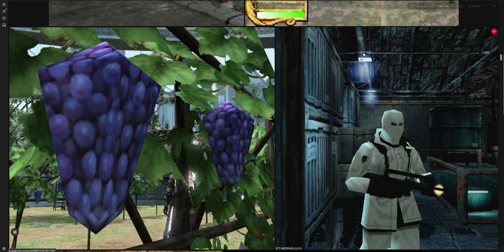
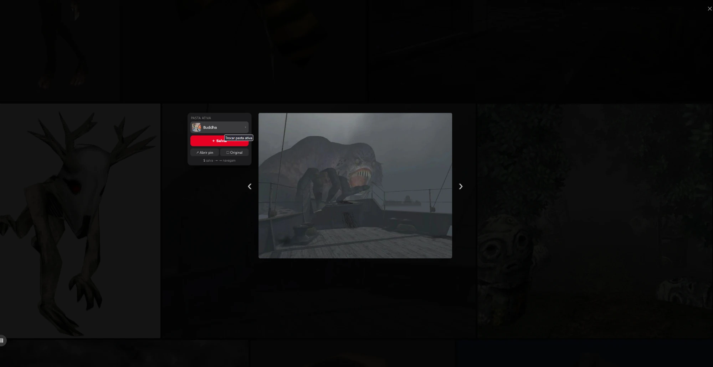
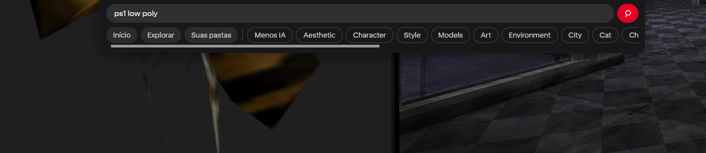

# Pinteless

**Pinterest, minus the clutter.**

Pinterest is great for finding references, but the page is busy: the masonry grid, the buttons on every pin, promoted stuff everywhere. Pinteless is a browser extension that hides all of that and shows **just the images**, in clean rows that fill your screen. Images are never stretched or cropped, they keep their real proportions.

It also lets you save pins to a board with **one click**, so you can blast through a search and collect what you like without opening a single pin page.



## What it does

- **Images only, in justified rows.** Every row fills the full width, and each image keeps its aspect ratio. You can choose the row height or a fixed number of images per row.
- **Fast.** Only the images on screen are actually drawn, so it stays smooth even after you've scrolled through thousands of pins.
- **Infinite scroll still works.** As you get to the bottom, Pinteless asks Pinterest for more pins behind the scenes.
- **Click to view.** Clicking an image opens it big in the middle of the screen, with a small panel on the left.
- **Active board + quick add.** Pick a board once, then save anything to it with a single click (or just press **S**).
- **Hidden search bar.** Move your mouse to the top edge to search, jump between your feed tabs, or use the filters of the current search.
- **Hides ads** (promoted pins) by default. You can hide videos too.





## Windows app

Pinteless also comes as a **desktop app for Windows**: a window that is just Pinterest with Pinteless built in. No browser, no extension to load. The gallery opens on its own.

### Download

Grab the latest `.exe` from the [Releases](https://github.com/mrlagosta2/pinteless/releases) page (or from the **Actions → Desktop (Windows)** run artifacts):

- `Pinteless-Setup-x.y.z.exe`: installer, with Start menu and desktop shortcuts.
- `Pinteless-x.y.z-portable.exe`: a single file, no install.

The app isn't code signed, so Windows SmartScreen may warn the first time. Click **More info → Run anyway**.

Log in to Pinterest inside the app once; the session is remembered.

### What's different from the extension

- Settings live in the menu: **Arquivo → Configurações…** (`Ctrl+,`). Press `Alt` to show the menu bar.
- `Alt+←` / `Alt+→` (or the mouse side buttons) go back / forward, `F5` reloads, `F11` is full screen, `Ctrl+N` opens a new window.
- Right-click an image to save it to your PC, copy it, or open it in the browser.
- Links that leave Pinterest open in your normal browser.

### Build it yourself

You need [Node.js](https://nodejs.org) 20+.

```bash
cd desktop
npm install
npm start          # run it
npm run dist       # build the Windows installer + portable exe into desktop/dist
```

Build the Windows `.exe` on Windows (or push a `v*` tag and let GitHub Actions do it). The desktop app reuses the extension files (`page.js`, `content.js`, `content.css`, `popup.html`) as they are. `desktop/preload.js` stands in for the browser extension APIs.

## Install (browser extension)

There's no store listing yet, so you load it manually. It takes about a minute.

First, download this repo: click **Code → Download ZIP** and unzip it somewhere (or `git clone` it).

### Firefox

1. Go to `about:debugging#/runtime/this-firefox`
2. Click **Load Temporary Add-on…**
3. Pick the `manifest.json` file inside the folder

Heads up: Firefox removes temporary add-ons when you close the browser, so you'll need to do this again after a restart. Firefox Developer Edition / Nightly can install it permanently if you set `xpinstall.signatures.required` to `false` in `about:config` and install a zipped `.xpi` of the folder.

### Chrome / Edge / Brave

1. Go to `chrome://extensions`
2. Turn on **Developer mode** (top right)
3. Click **Load unpacked** and pick the folder

This one sticks around after restarts.

## How to use it

1. Open Pinterest and log in like you normally would.
2. Search for something, or open your home feed.
3. Click the round button in the bottom left corner, or press **Alt+Shift+G**. That's gallery mode. Press it again (or **Esc**) to go back to normal Pinterest.

You can also turn on "open automatically" in the settings if you want Pinteless to be your default view.

### Saving pins (the good part)

1. Click any image. It opens big, with a panel on the left.
2. In the panel, click the board name under **Pasta ativa** (active board) and pick one of your boards. You can type to filter, or create a new board right there.
3. That board is now your **active board**. It's remembered, and you can see it in the toolbar (📌).

From now on, saving to that board is one click:

- hover any image in the grid and hit the red **＋** in the corner, or
- click **Salvar** in the panel, or
- press **S** (it saves the image that's open, or the one under your mouse).

Saved images get a green ✓ so you know what you already grabbed. Want a different board? Open any image and switch it in the panel.

If you hit quick add before choosing a board, Pinteless just asks you to pick one and then saves.

### Shortcuts

| Key | What it does |
| --- | --- |
| `Alt+Shift+G` | open / close the gallery |
| `S` | save to the active board |
| `←` `→` | previous / next image (in the viewer) |
| `+` `−` | bigger / smaller rows |
| `/` or `Ctrl+K` | open the search bar |
| `Esc` | close whatever is open (picker → search bar → viewer → gallery) |

### Settings

Click the extension icon in your browser toolbar to change things. Everything applies live:

- row height, or number of images per row
- gap between images and corner rounding
- max row height (so a super wide image doesn't get huge)
- what to do with the last row (left aligned, stretched to fill, or hidden)
- image quality (auto picks the right size for the space)
- hide ads / hide videos
- what clicking an image does (viewer, open the pin, or open in a new tab)
- background color, and whether to show the floating button

> The interface is in Portuguese for now (it started as a personal project). The labels are simple, and translations are very welcome!

## Privacy

Pinteless doesn't collect anything and doesn't talk to any server except Pinterest itself.

- There are no analytics, no tracking, and no third party requests.
- Saving pins and listing your boards uses Pinterest's own website API, from inside the Pinterest tab, with the login you already have there. It's the same thing that happens when you click "Save" on the site. Pinteless never reads, stores, or sends your password or session anywhere.
- Your settings and your active board are stored only in your browser's extension storage.
- It only runs on Pinterest domains, and the only permission it asks for is `storage`.

The code is small and readable, so feel free to check it yourself.

## How it works (for the curious)

- `content.js` reads the pins that Pinterest already loaded on the page (image URLs and their aspect ratio), then draws its own gallery on top. The real page keeps running hidden underneath, which is how infinite scroll keeps working.
- The layout is a justified row algorithm: images are added to a row until it's wide enough, then the row height is adjusted so it fits the width exactly.
- Only the visible images are kept in the page (virtualization), so scrolling stays smooth.
- `page.js` runs in the page itself so that the save and board requests look exactly like the ones Pinterest makes. The content script talks to it through `postMessage`.

Pinterest changes their site sometimes. If something breaks, open an issue (a screenshot plus the browser console errors help a lot).

## Contributing

PRs and issues are welcome: bug fixes, translations, ideas, whatever. There's no build step. Edit the files, reload the extension, and refresh Pinterest.

## License

MIT. Do whatever you want with it, see [LICENSE](LICENSE).

*Not affiliated with Pinterest.*
